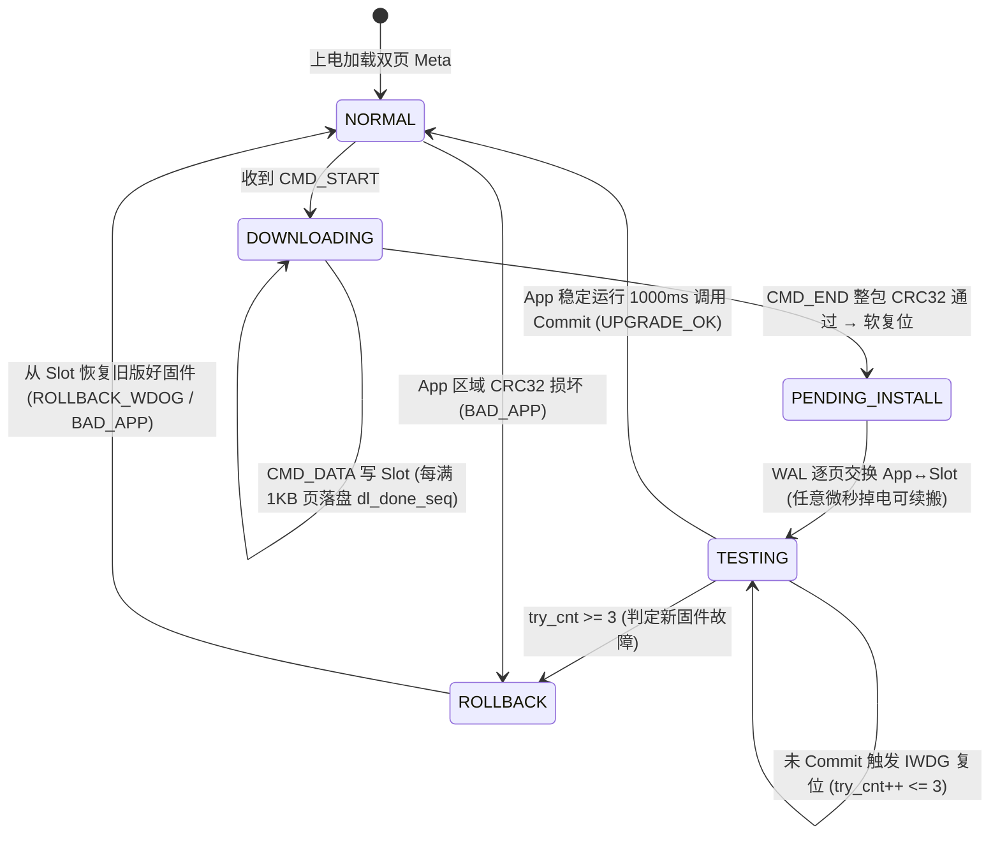

# SafeBoot-F1 — 面向工业现场的防变砖 IAP 固件升级系统

> 基于 **STM32F103C8T6（64 KB Flash / 20 KB SRAM）** 的纯寄存器级防变砖 Bootloader 与全栈验证系统。
> 零外部 Flash、零 HAL/标准库依赖，在 64 KB 片内 Flash 内完整实现 **双页掉电安全 Meta**、**WAL 预写日志式 A↔B 页交换安装**、**看门狗 3 次试运行自动回滚**、**1 KB 页边界断点续传**，并通过 **PC 1167 断言单元测试 + SIL 软件在环仿真 + STM32F103C8T6 真板实测** 三级闭环验证。

---

## 一、核心特性与实测指标

| 维度 | 设计与实测指标 |
|---|---|
| **Bootloader 体积** | **4,784 B**（Code `4444B` + RO `332B` + RW `8B`），仅占 8 KB 预算的 **58.4%**，零 HAL/SPL 依赖 |
| **硬件写保护** | FPEC 驱动层强制拦截 `< 0x08002000` 任意擦/写，确保 Bootloader 永不被自毁 |
| **元数据可靠性** | 双页主备存储（`0x0800E000 / 0x0800E400`），**先备后主 + 32 位递增 `seq` + CRC16-Modbus + 读回校验** |
| **搬运掉电防护** | **WAL 预写日志双暂存页逐页交换**（`App ↔ Slot`），PC 单元测试穷举 **93/93 步擦写撕裂掉电 100% 可续搬** |
| **故障自动回滚** | `STATE_TESTING` 试运行态开启 2 s 独立看门狗（IWDG），新固件连续 3 次未调用 `boot_meta_commit_app()` 自动从 Slot 恢复上一版好固件 |
| **抗噪与续传协议** | `0xAA55` 二进制分包协议（128 B/包），分包 CRC16 + 整包 IEEE 802.3 CRC32（64 B 半字节查表），支持重复 `seq` 幂等应答、乱序拦截与 1 KB 页对齐断点续传 |
| **全栈验证体系** | PC 单元测试 **1167 / 1167 PASS** · SIL 管道对打 **4 / 4 PASS** · Keil ARMCC V5.06 **4/4 目标 0 Error 0 Warning** · 真板 **5 / 5 PASS** |

---

## 二、64 KB 片内 Flash 分区规划

```text
0x0800 0000 ┌──────────────────────────────────────────┐
            │  Bootloader 区  (8 KB, Page 0~7)          │  ← 硬写保护线 (< 0x08002000 禁止擦写)
0x0800 2000 ├──────────────────────────────────────────┤
            │  App 运行区     (24 KB, Page 8~31)        │  ← 当前运行固件，App 首行 SCB->VTOR = 0x08002000
0x0800 8000 ├──────────────────────────────────────────┤
            │  Slot 下载/备份区 (24 KB, Page 32~55)     │  ← 下载暂存新固件；WAL 交换后自动保存上一版好固件
0x0800 E000 ├──────────────────────────────────────────┤
            │  Boot Meta 主页 (1 KB, Page 56)           │  ← 56B 结构体（magic/seq/meta/crc16）
0x0800 E400 ├──────────────────────────────────────────┤
            │  Boot Meta 备页 (1 KB, Page 57)           │  ← 先写备页、校验通过后再写主页
0x0800 E800 ├──────────────────────────────────────────┤
            │  WAL 暂存页 OLD (1 KB, Page 58)           │  ← 交换第 i 页前备份 App[i]
0x0800 EC00 ├──────────────────────────────────────────┤
            │  WAL 暂存页 NEW (1 KB, Page 59)           │  ← 交换第 i 页前备份 Slot[i]
0x0800 F000 ├──────────────────────────────────────────┤
            │  WAL 事务标签页 (1 KB, Page 60)           │  ← 写入 0x53570000 | page_idx 作为提交点
0x0800 F400 ├──────────────────────────────────────────┤
            │  预留页         (1 KB, Page 61)           │
0x0800 F800 ├──────────────────────────────────────────┤
            │  应用参数双区   (2 KB, Page 62~63)        │  ← 预留给业务参数（与工业模块参数区兼容）
0x0800 FFFF └──────────────────────────────────────────┘
```

---

## 三、五态防变砖状态机与 WAL 搬运原理



### WAL 两阶段原子页交换（解决“64 KB 无第三份空间”难题）
对每一页 `i = swap_page_idx .. total_pages - 1`：
1. **阶段 A（建快照）**：若 `WAL_TAG != (0x53570000 | i)`，将 `App[i] → SCRATCH_OLD`、`Slot[i] → SCRATCH_NEW`，最后写 `WAL_TAG = 0x53570000 | i`。此阶段 `App[i]` 和 `Slot[i]` 均未被修改，掉电无任何损失。
2. **阶段 B（落目标）**：将 `SCRATCH_NEW → App[i]`、`SCRATCH_OLD → Slot[i]`，完成后递增 `swap_page_idx` 并双页持久化 Meta。若阶段 B 任意微秒掉电，重启检测到 `WAL_TAG == (0x53570000 | i)`，跳过阶段 A 直接重刷阶段 B，100% 恢复不丢字节。

---

## 四、IAP 二进制分包协议规范

小端字节序，串口参数 `9600 8N1`（兼顾 RS-485 半双工，`PA8` 控制 DE 且等待 `USART_SR_TC` 防止末字节截断）：

```text
+------+------+-----+---------------+---------------+------------------+----------------+
| 0xAA | 0x55 | cmd | seq / status  |      len      |     payload      |     crc16      |
|  1B  |  1B  | 1B  |   2B (LE)     |    2B (LE)    |    0 ~ 136 B     |    2B (LE)     |
+------+------+-----+---------------+---------------+------------------+----------------+
```

| 命令字 | 名称 | 方向 / 说明 |
|---|---|---|
| `0x01` | `CMD_START` | 下发 `version(4B) + size(4B) + crc32(4B) + flags(2B)`；`flags.bit0=1` 启用断点续传，应答返回 `resume_seq(2B)` |
| `0x02` | `CMD_DATA` | `seq = 0,1,2...`，每包 128 B（末包可 `<128`，偶数）；旧 `seq` 幂等返回 OK 不重擦写，跳包返回 `ERR_SEQ` 与期望序号 |
| `0x03` | `CMD_END` | 校验总包数与 Slot 整包 CRC32，通过后写 `PENDING_INSTALL` 并置位软复位 |
| `0x04` | `CMD_QUERY` | 返回 24 B 运行状态（`run_mode` / `state` / `try_cnt` / `last_event` / `dl_done_seq` / `app_*` / `slot_version`） |
| `0x05` | `CMD_REBOOT` | 请求软复位（运行态 App 收到后复位移交 Bootloader 300 ms 握手窗口） |

---

## 五、工程目录结构

```text
safeboot_f1/
├── README.md                              ← 本文件
├── .gitignore
├── docs/
│   ├── 01_实验数据与测试报告.md            ← PC 单元测试 / SIL / 真板 5 项实测数据与时序分析
│   ├── 02_简历写法与项目亮点.md            ← 嵌入式简历模板 + 技术亮点拆解 + 面试深挖 Q&A
│   └── 交接文档.md                        ← 全阶段研发与验收进度记录
├── release/                               ← 预编译固件发行包（.bin / .hex，可直接烧录/升级）
│   ├── SafeBoot_Boot.hex / .bin
│   ├── SafeBoot_App_v10.bin / .hex
│   ├── SafeBoot_App_v11.bin / .hex
│   └── SafeBoot_App_v12_bad.bin / .hex
└── firmware/
    ├── common/                            ← common.h, crc16.c/.h, crc32.c/.h
    ├── bsp/                               ← bsp.c/.h (72MHz/USART1/IWDG), bsp_flash.c/.h (FPEC)
    ├── middleware/                        ← boot_meta.c/.h (双页Meta+WAL状态机), iap_proto.c/.h
    ├── boot/                              ← boot_jump.c/.h (6步安全跳转), boot_main.c
    ├── app/                               ← app_main.c (VTOR重定位 + 1000ms自检Commit + 故障变体)
    ├── tools/                             ← test_boot.c, run_test_boot.ps1, upgrader.py
    ├── host_sim/                          ← safeboot_sim.c, build.ps1, run_sil_test.py
    └── MDK/                               ← SafeBoot_Boot.uvprojx, SafeBoot_App.uvprojx, build_all.ps1
```

---

## 六、快速上手（构建、仿真与真板升级）

### 1. PC 端一键回归（无需硬件）
```powershell
# (1) 运行 1167 项断言 PC 单元测试（含 93 步 WAL 撕裂掉电穷举）
& ".\firmware\tools\run_test_boot.ps1"

# (2) 编译并运行 SIL 软件在环 4 场景全流程对打
& ".\firmware\host_sim\build.ps1"
python .\firmware\host_sim\run_sil_test.py

# (3) 一键调用 Keil MDK 编译全部 4 个固件镜像（需本机安装 Keil uVision5）
& ".\firmware\MDK\build_all.ps1"
```

### 2. STM32F103C8T6 真板实测（ST-Link V2 + USB-TTL COM3）
> `upgrader.py` 内置零依赖 Win32 原生串口回退，未安装 `pyserial` 也可直接用系统 `python` 运行。

```powershell
# (1) Keil 打开 firmware\MDK\SafeBoot_Boot.uvprojx 按 F8 烧录 Bootloader（0x08000000）

# (2) 查询 Bootloader 状态
python .\firmware\tools\upgrader.py --port COM3 --baud 9600 query

# (3) 首次刷入 App v1.0（成功后 PC13 500ms 慢闪）
python .\firmware\tools\upgrader.py --port COM3 --baud 9600 upgrade .\release\SafeBoot_App_v10.bin --version 1.0 --wait-boot 3.5

# (4) 运行态升级至 App v1.1（成功后 PC13 125ms 快闪，Slot 自动留存 v1.0 备份）
python .\firmware\tools\upgrader.py --port COM3 --baud 9600 upgrade .\release\SafeBoot_App_v11.bin --version 1.1 --wait-boot 3.5

# (5) 破坏性实验：刷入死锁坏固件 v1.2-BAD，等待 3 次硬件 IWDG 复位自动回滚至上一版好固件
python .\firmware\tools\upgrader.py --port COM3 --baud 9600 upgrade .\release\SafeBoot_App_v12_bad.bin --version 1.2 --wait-boot 10.0
```
